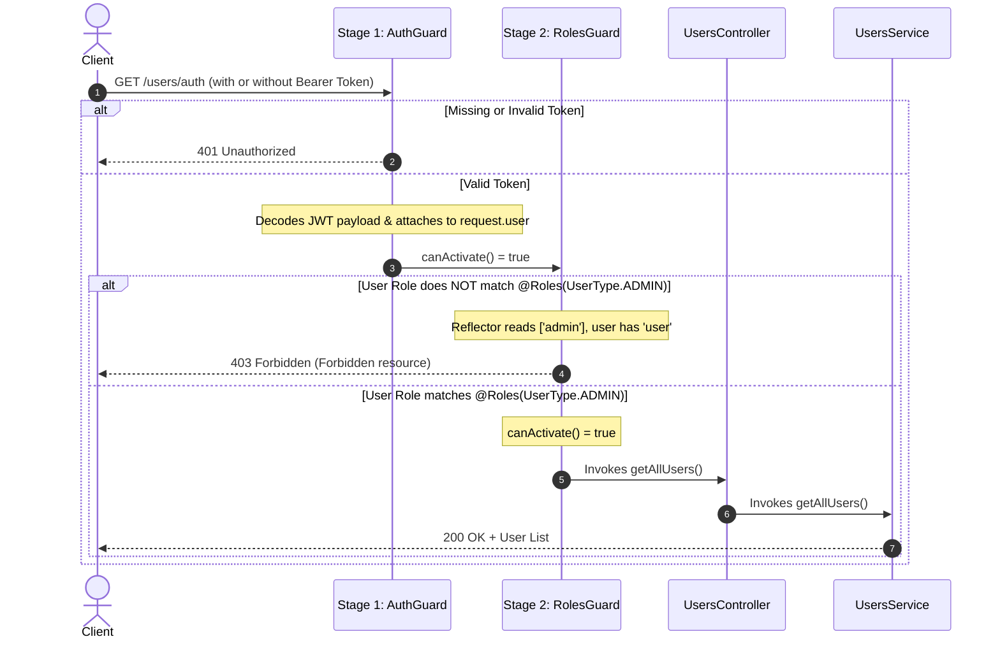

# Authentication & Role-Based Access Control (RBAC) Architecture Guide

> **Version:** `v0`  
> **Status:** Active / Approved  
> **Scope:** Authentication (`AuthGuard`), Authorization (`RolesGuard`), Metadata Reflection (`@Roles`)

## 1. Executive Summary

This document explains the **Authentication** and **Role-Based Access Control (RBAC)** architecture implemented in this NestJS application. It covers:
- Decorator lifecycle and metadata reflection (`@Roles`, `SetMetadata`, `Reflector`).
- Guard execution pipeline (`AuthGuard` ➔ `RolesGuard`).
- The in-memory Request object lifecycle.
- HTTP `401 Unauthorized` vs `403 Forbidden`.
- Step-by-step execution flows and edge cases.

---

## 2. Request Lifecycle & Sequence Flow

When a client sends an HTTP request to a protected endpoint (e.g., `GET /users/auth`), the request flows through a two-stage security checkpoint before ever reaching the controller handler:



---

## 3. Behind the Scenes: Decorators & Metadata

A common misconception is that decorators run on every HTTP request. **They do not.**

### When do Decorators run?
- **Decorators execute ONCE at application boot time (bootstrap)** when TypeScript loads the class.
- When `@Roles(UserType.ADMIN)` is parsed, it calls `SetMetadata('roles', [UserType.ADMIN])`.
- NestJS stores this key-value pair in an internal metadata registry attached to that specific route handler function.

```typescript
// src/users/decorators/user-role.decorator.ts
export const ROLES_KEY = 'roles';
export const Roles = (...roles: UserType[]) => SetMetadata(ROLES_KEY, roles);
```

### How does `RolesGuard` read this metadata?
During an active request, `RolesGuard` uses Nest's built-in `Reflector` service:
```typescript
const requiredRoles = this.reflector.getAllAndOverride<UserType[]>(ROLES_KEY, [
    context.getHandler(), // Checks method-level metadata first
    context.getClass(),   // Falls back to controller class-level metadata
]);
```
- If no `@Roles` decorator was placed on the route, `requiredRoles` will be `undefined`, allowing the request to proceed.

---

## 4. The Request Object Lifecycle: Where is `user` stored?

In `AuthGuard`:
```typescript
const payload = await this.jwtService.verifyAsync<JwtPayload>(token);
request.user = payload; // { userId: "...", userType: "admin" }
```

### Is `user` injected into the HTTP headers?
**No.** 
- HTTP headers (`request.headers`) are incoming strings sent by the client over the network.
- `request.user` is a dynamic property attached to the **in-memory JavaScript Request object** in the Node.js/Express process.
- It lives only for the duration of that single HTTP request and is automatically garbage-collected when the response is returned.
- This allows subsequent guards (`RolesGuard`), parameter decorators (`@CurrentUser()`), and controllers to access authenticated user data without re-verifying or re-decoding the JWT.

---

## 5. HTTP Status Codes: 401 vs 403 Explained

| Status Code | Standard Name | Responsibility | Trigger in Code | Real-World Analogy |
| :--- | :--- | :--- | :--- | :--- |
| **`401`** | **Unauthorized** *(Authentication)* | **Identity Verification**: "Who are you?" | Thrown explicitly in `AuthGuard`: `throw new UnauthorizedException(...)` | Visiting a building with **no ID card**. The security guard stops you at the gate. |
| **`403`** | **Forbidden** *(Authorization)* | **Permission Check**: "I know who you are, but you cannot enter here." | Returned by `RolesGuard`: `return false` (NestJS converts `false` to `ForbiddenException`) | You showed a valid ID card as a regular employee, but tried to enter the **Executive Server Room**. |

---

## 6. Execution Scenarios & Edge Cases

### Scenario A: No `Authorization` Header
1. Client sends request without `Authorization` header.
2. `AuthGuard.canActivate()` runs: detects missing header.
3. Throws `UnauthorizedException("Authorization header is missing")` ➔ **`401`**.
4. Execution aborts immediately: `RolesGuard` and Controller are **never invoked**.

### Scenario B: Expired or Corrupted Token
1. Client sends `Bearer eyJ...` with an expired timestamp or tampered signature.
2. `AuthGuard` executes `this.jwtService.verifyAsync(token)`: rejects.
3. Caught in `catch` block ➔ throws `UnauthorizedException("Invalid or expired token")` ➔ **`401`**.

### Scenario C: Authenticated User with Role `user`
1. Client sends a valid token belonging to a regular user.
2. `AuthGuard.canActivate()` validates token, sets `request.user = { userId: "...", userType: "user" }`, and returns `true`.
3. `RolesGuard.canActivate()` runs:
   - `reflector.getAllAndOverride` reads `['admin']`.
   - `request.user.userType` is `'user'`.
   - `requiredRoles.includes('user')` evaluates to `false`.
4. Returns `false` ➔ NestJS catches this and responds with **`403 Forbidden`**.
5. Controller's `getAllUsers()` is **never invoked**.

### Scenario D: Authenticated User with Role `admin`
1. `AuthGuard.canActivate()` runs: validates token, sets `request.user`, returns `true`.
2. `RolesGuard.canActivate()` runs: matches `'admin'` in `['admin']`, returns `true`.
3. `UsersController.getAllUsers()` executes.
4. `UsersService.getAllUsers()` executes database query.
5. Returns **`200 OK`** with data.

### Scenario E: Route without `@Roles()` metadata (NestJS Default vs. Our Fail-Fast Policy)

#### 1. What is the NestJS Default?
In official NestJS tutorials, guards typically do:
```typescript
if (!requiredRoles || requiredRoles.length === 0) {
    return true; // Allow by default
}
```
**The Rationale for the Default:** If `RolesGuard` is registered globally across all routes, routes with no `@Roles` decorator simply pass through.

#### 2. The Vulnerability with the Default:
- If a developer applies `RolesGuard` to a critical endpoint but **forgets** to add `@Roles(...)`, the default `return true` silently allows all authenticated users through!
- This is a silent security hazard: **Broken Access Control** (OWASP #1).

#### 3. Why we chose Fail-Fast Alerting (`InternalServerErrorException`):
In our project, we adopted the **Strict / Fail-Fast** principle:
```typescript
if (!requiredRoles || requiredRoles.length === 0) {
    const handlerName = context.getHandler().name;
    throw new InternalServerErrorException(
        `Developer Error: RolesGuard is applied to '${handlerName}', but no roles are defined using the @Roles() decorator.`
    );
}
```
**Advantages of our approach:**
- **Zero Ambiguity:** If you put `RolesGuard` on a route, you *must* declare `@Roles(...)`.
- **Immediate Alert in Development:** If a developer forgets the decorator, the API immediately fails with an explicit 500 message pointing to the exact method name during testing.
- **Fail-Safe:** No protected route can ever accidentally open to all users due to human error.
- **Routes that don't need role checks** (like `getMe`) simply use `@UseGuards(AuthGuard)` without attaching `RolesGuard`.

### Scenario F: `RolesGuard` applied without `AuthGuard`
- If someone misconfigures `@UseGuards(RolesGuard)` without `AuthGuard`:
- `request.user` will be `undefined`.
- Safety check:
  ```typescript
  if (!user || !user.userType) {
      return false; // Safely denies access (403) instead of throwing TypeError
  }
  ```

---

## 7. How to Apply to Future Routes

### Protecting an endpoint for Admins only:
```typescript
@Get('admin-only')
@Roles(UserType.ADMIN)
@UseGuards(AuthGuard, RolesGuard)
adminEndpoint() {
    return 'Only admins can see this';
}
```

### Allowing multiple roles:
```typescript
@Get('shared')
@Roles(UserType.ADMIN, UserType.USER)
@UseGuards(AuthGuard, RolesGuard)
sharedEndpoint() {
    return 'Admins and users can see this';
}
```

### Extracting authenticated user info inside any Controller:
```typescript
@Get('profile')
@UseGuards(AuthGuard)
getProfile(@CurrentUser() user: JwtPayload) {
    return user; // Access user.userId, user.userType directly
}
```

---

## 8. Soft Deletion, Admin Bans & Daily Cron Cleanup

### 1. Self-Deletion vs. Admin Ban
We distinguish between user-initiated account deletion and administrative bans via the `deletedByAdmin` column:

- **User Self-Deletion (`deletedByAdmin = false`):**
  - Soft-deletes the record with `deletedAt = NOW()`.
  - The user has a **30-day grace period** to change their mind.
  - Logging in within 30 days automatically **restores** the account.
- **Admin Ban / Deletion (`deletedByAdmin = true`):**
  - Marks `deletedByAdmin = true` and soft-deletes the record.
  - When the user attempts to log in within 30 days, they receive:
    `403 Forbidden: "Your account has been suspended by an administrator. Please contact an administrator within 30 days to appeal."`
  - The user **cannot** self-restore their account. Only an Admin can restore them via:
    `PATCH /users/auth/:id/restore`

### 2. Automatic Daily Cron Purge
After 30 days of deletion, the account is permanently purged from PostgreSQL:
- Managed by `UsersCleanupService` via `@nestjs/schedule`.
- Runs automatically at **midnight (00:00:00)** daily:
  ```typescript
  @Cron(CronExpression.EVERY_DAY_AT_MIDNIGHT)
  async handleExpiredAccountCleanup() {
      const thirtyDaysAgo = new Date(Date.now() - 30 * 24 * 60 * 60 * 1000);
      const expiredUsers = await this.usersRepository.find({
          withDeleted: true,
          where: { deletedAt: LessThan(thirtyDaysAgo) }
      });
      if (expiredUsers.length > 0) {
          await this.usersRepository.remove(expiredUsers); // Permanent Hard Delete
      }
  }
  ```

