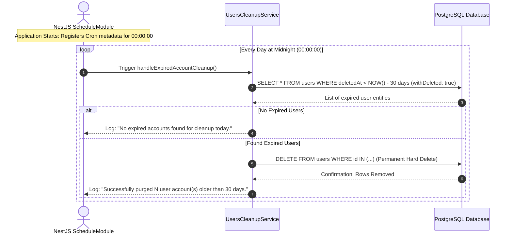

# Background Task Scheduling & Cron Job Architecture Guide

> **Document Type:** Technical & Engineering Guide  
> **Status:** Active / Implemented  
> **Module:** `UsersCleanupService` via `@nestjs/schedule`  
> **Subject:** Automated Account Purging & Database Lifecycle Management  

---

## 1. What is a Cron Job?

A **Cron Job** is an automated, time-based scheduled task that executes periodically in the background without requiring user interaction or an incoming HTTP request.

### 1.1 The Concept & Etymology
- The name originated from the Unix daemon **`cron`** (derived from the Greek word *Chronos* meaning "time").
- Unlike standard API endpoints that are **reactive** (they only run when a client sends an HTTP request), a Cron Job is **proactive** (it wakes up on a predetermined schedule, performs maintenance, and returns to sleep).

### 1.2 The Cron Syntax
A standard cron expression consists of 5 or 6 fields separated by spaces:

```text
 ┌────────────── minute (0 - 59)
 │ ┌──────────── hour (0 - 23)
 │ │ ┌────────── day of month (1 - 31)
 │ │ │ ┌──────── month (1 - 12)
 │ │ │ │ ┌────── day of week (0 - 7, where 0 and 7 = Sunday)
 │ │ │ │ │
 * * * * *
```

In NestJS, `@nestjs/schedule` provides human-readable constants via `CronExpression`:
- `CronExpression.EVERY_DAY_AT_MIDNIGHT` ➔ `0 0 * * *` (Runs every day at `00:00:00` UTC/Server time).

---

## 2. Why do we need a Cron Job in our Project?

When a user deletes their account (or when an admin suspends it), we perform a **Soft Delete**:
```typescript
await this.usersRepository.softRemove(user);
```

### The Problem with Soft Deletes Alone:
1. **Database Bloat:** The row is **never actually deleted** from PostgreSQL. It remains stored on disk indefinitely with a timestamp in `deletedAt`. Over months and years, millions of deleted rows pollute indexes and degrade database performance.
2. **Business Promise Violation:** Our business policy promises that the account has a **30-day grace period** to recover or appeal, after which the account is **permanently destroyed**. Without an automated job, the account remains in the database forever.
3. **Legal & Privacy Compliance (GDPR / CCPA):** Under privacy laws (e.g., GDPR "Right to be Forgotten"), companies are legally required to permanently purge personally identifiable information (PII) once the retention window expires.

---

## 3. How `@nestjs/schedule` Works Under the Hood



### The NestJS Runtime Lifecycle:
1. **Module Registration:** `ScheduleModule.forRoot()` in [app.module.ts](file:///c:/Users/joo/Desktop/projects/Learning/learning-nestjs/src/app.module.ts) initializes an internal task scheduler registry when the NestJS application boots.
2. **Discovery & Reflection:** NestJS scans all registered providers for the `@Cron()` decorator. When it finds `@Cron(CronExpression.EVERY_DAY_AT_MIDNIGHT)` in `UsersCleanupService`, it schedules a recurring timer in the Node.js event loop.
3. **Autonomous Execution:** When the system clock strikes midnight, the timer fires and invokes the decorated method asynchronously.

---

## 4. Code Breakdown & Implementation Details

Our cron implementation is encapsulated in [src/users/users-cleanup.service.ts](file:///c:/Users/joo/Desktop/projects/Learning/learning-nestjs/src/users/users-cleanup.service.ts):

```typescript
import { Injectable, Logger } from "@nestjs/common";
import { Cron, CronExpression } from "@nestjs/schedule";
import { InjectRepository } from "@nestjs/typeorm";
import { LessThan, Repository } from "typeorm";
import { User } from "./user.entity.js";

@Injectable()
export class UsersCleanupService {
    // 1. Built-in Logger for production audit trails
    private readonly logger = new Logger(UsersCleanupService.name);

    constructor(
        @InjectRepository(User)
        private readonly usersRepository: Repository<User>,
    ) {}

    // 2. Scheduled trigger: runs every night at 00:00:00
    @Cron(CronExpression.EVERY_DAY_AT_MIDNIGHT)
    async handleExpiredAccountCleanup(): Promise<void> {
        this.logger.log("Running scheduled purge of expired accounts (>30 days deleted)...");

        // 3. Compute the exact 30-day cutoff timestamp
        const thirtyDaysAgo = new Date(Date.now() - 30 * 24 * 60 * 60 * 1000);

        // 4. Query database for records deleted BEFORE the cutoff date
        const expiredUsers = await this.usersRepository.find({
            withDeleted: true, // Crucial: overrides TypeORM's default "deletedAt IS NULL" filter
            where: {
                deletedAt: LessThan(thirtyDaysAgo), // Equivalent to: deletedAt < thirtyDaysAgo
            },
        });

        // 5. Permanent physical removal (Hard Delete)
        if (expiredUsers.length > 0) {
            await this.usersRepository.remove(expiredUsers); // Sends raw SQL: DELETE FROM users WHERE id = ...
            this.logger.log(`Successfully purged ${expiredUsers.length} user account(s) older than 30 days.`);
        } else {
            this.logger.log("No expired accounts found for cleanup today.");
        }
    }
}
```

### Critical Lines Explained:

| Code Segment | Explanation |
| :--- | :--- |
| `withDeleted: true` | By default, TypeORM automatically hides soft-deleted rows. Passing `withDeleted: true` instructs TypeORM to query all rows, including those where `deletedAt IS NOT NULL`. |
| `LessThan(thirtyDaysAgo)` | A TypeORM query operator translated to SQL `deletedAt < $1`. If today is Nov 14, it finds all records deleted on or before Oct 15. |
| `usersRepository.remove(...)` | Unlike `softRemove(...)`, calling `remove(...)` on entities that already have `deletedAt` populated triggers a **physical SQL `DELETE` statement**, completely erasing the data from disk. |
| `this.logger.log(...)` | Emits timestamped, color-coded server logs for observability and auditing without cluttering `console.log`. |

---

## 5. Complete Account Deletion Lifecycle

```text
1. User Deletes Account:
   DELETE /users/auth/me 
   ➔ UPDATE users SET "deletedAt" = NOW(), "deletedByAdmin" = false WHERE id = '...';

2. Days 1 to 30 (Grace Period Window):
   - Row exists in PostgreSQL.
   - Invisible to normal queries (find, getAllUsers).
   - If user logs in: Account is restored via restore() and login succeeds!

3. Day 31+ (Grace Period Expired):
   - User attempts login ➔ 400 Bad Request: "Account deleted > 30 days ago".
   - At Midnight (00:00:00): UsersCleanupService runs:
     ➔ DELETE FROM users WHERE id = '...'; (Physically erased forever!)
```

---

## 6. Enterprise & Production Considerations

1. **Multi-Instance / Cluster Deployments:**
   - In distributed deployments (e.g., Kubernetes with multiple replica pods), running an in-process cron job on every pod can cause concurrent duplicate executions.
   - **Solution in large scale:** Use a centralized job queue such as **BullMQ** (powered by Redis) or a dedicated single-instance Worker container. For single-server or standard production setups, `@nestjs/schedule` is the recommended, zero-overhead solution.
2. **Chunking / Pagination for Large Datasets:**
   - If millions of accounts expire simultaneously, deleting them all in a single array can lock the database. For very large scale, querying in batches of 500 or 1,000 using `take: 1000` is recommended.
3. **Database Cascading:**
   - Thanks to TypeORM relations and PostgreSQL foreign keys, any associated child tables (such as user reviews or products) should have `ON DELETE CASCADE` configured to maintain relational integrity upon hard deletion.
