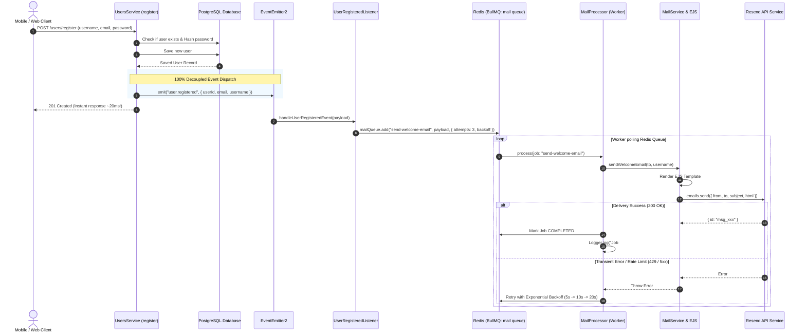

# Email Notification System & Architecture Guide

> **Document Type:** Technical & Engineering Guide  
> **Status:** Active / Implemented  
> **Module:** `MailModule` (`MailService`, `MailProcessor`, `UserRegisteredListener`)  
> **Integrations:** Resend API, BullMQ, Redis, EventEmitter2, EJS Template Engine  
> **Subject:** Event-Driven Transactional Emails with Durable Message Queues  

---

## 1. Overview & Objectives

In modern web applications, transactional emails (e.g., Welcome Emails, Password Reset, Email Verification, Invoice receipts) are vital for user engagement and system security.

Our project integrates an enterprise-grade, resilient, and completely decoupled **Event-Driven Email System** using:
- **[Resend](https://resend.com/):** Modern developer-first email delivery platform.
- **[BullMQ](https://docs.bullmq.io/) + [Redis](https://redis.io/):** High-performance, durable message queue guaranteeing zero-loss job processing, concurrency throttling, and automatic retries with exponential backoff.
- **[EventEmitter2](https://docs.nestjs.com/techniques/events):** Pure architectural decoupling where domain services (like `UsersService`) emit domain events without depending on or knowing about the mailing module.
- **[EJS (Embedded JavaScript Templates)](https://ejs.co/):** Robust templating engine allowing dynamic data injection into responsive HTML emails.

---

## 2. Architecture & Request Flow

The following diagram illustrates how an event (like User Registration) triggers the queue workflow without blocking the client or coupling modules:



---

## 3. Environment & Infrastructure Setup

### 3.1 Docker Compose Services
In [`docker-compose.yml`](file:///c:/Users/joo/Desktop/projects/Learning/learning-nestjs/docker-compose.yml), Redis runs alongside PostgreSQL:

```yaml
  redis:
    image: redis:7-alpine
    container_name: learning_nest_redis
    restart: always
    ports:
      - "6379:6379"
    volumes:
      - redisdata:/data

volumes:
  pgdata:
  redisdata:
```

### 3.2 Environment Variables ([`.env`](file:///c:/Users/joo/Desktop/projects/Learning/learning-nestjs/.env))
```env
# Resend Mail Configuration
RESEND_API_KEY=re_your_api_key_here
MAIL_FROM="Learning NestJS <onboarding@resend.dev>"

# Redis & Queue Configuration
REDIS_HOST=localhost
REDIS_PORT=6379
```

> [!IMPORTANT]
> **Resend Free Tier Testing Rule:**
> If you have not verified your own custom domain in Resend, you can only send emails from `onboarding@resend.dev` to the **single email address associated with your Resend account**. Attempting to send to arbitrary third-party emails will return a `403 Forbidden: domain not verified` error from Resend until you connect a custom domain.

---

## 4. Architectural Decoupling: Event-Driven Pattern

### Why EventEmitter2?
In standard architectures, `UsersService` imports `MailService`. This creates **tight coupling**:
1. Any change in email dependencies impacts user management.
2. If we later want to send an SMS or record analytics upon registration, `UsersService` becomes cluttered with multiple unrelated services.

### With EventEmitter:
`UsersService` is solely responsible for user management. It simply emits an event:
```typescript
//* Emit domain event for user registration (triggers decoupled queue processing)
this.eventEmitter.emit(EVENT_USER_REGISTERED, {
    userId: savedUser.id,
    email: savedUser.email,
    username: savedUser.username,
});
```
`UsersModule` no longer imports `MailModule`.

---

## 5. Message Queue: BullMQ & Worker Implementation

### 5.1 Event Listener ([`src/mail/listeners/user-registered.listener.ts`](file:///c:/Users/joo/Desktop/projects/Learning/learning-nestjs/src/mail/listeners/user-registered.listener.ts))
Listens for the domain event and enqueues the job with enterprise retry configuration:

```typescript
@OnEvent(EVENT_USER_REGISTERED)
async handleUserRegisteredEvent(payload: UserRegisteredEventPayload): Promise<void> {
    const job = await this.mailQueue.add(JOB_SEND_WELCOME_EMAIL, {
        to: payload.email,
        username: payload.username,
    }, {
        attempts: 3,
        backoff: {
            type: "exponential",
            delay: 5000, // Retries at 5s, 10s, 20s
        },
        removeOnComplete: {
            age: 3600 * 24, // Keep completed jobs for 24 hours
            count: 100,
        },
        removeOnFail: {
            count: 500,     // Keep failed jobs for inspection
        },
    });
}
```

### 5.2 Worker Processor ([`src/mail/mail.processor.ts`](file:///c:/Users/joo/Desktop/projects/Learning/learning-nestjs/src/mail/mail.processor.ts))
Runs in the background, consumes jobs from the Redis queue, and invokes `MailService`:

```typescript
@Processor(MAIL_QUEUE)
export class MailProcessor extends WorkerHost {
    async process(job: Job<any, any, string>): Promise<any> {
        switch (job.name) {
            case JOB_SEND_WELCOME_EMAIL: {
                const data = job.data as SendWelcomeEmailJobData;
                await this.mailService.sendWelcomeEmail(data.to, data.username);
                return { delivered: true, to: data.to };
            }
        }
    }

    @OnWorkerEvent("completed")
    onCompleted(job: Job): void {
        this.logger.log(`Job #${job.id} "${job.name}" successfully completed.`);
    }

    @OnWorkerEvent("failed")
    onFailed(job: Job, error: Error): void {
        this.logger.error(`Job #${job.id} failed on attempt ${job.attemptsMade}: ${error.message}`);
    }
}
```

---

## 6. Template Engine & NestJS Compilation Pipeline

### 6.1 Asset Copying via `nest-cli.json`
In [`nest-cli.json`](file:///c:/Users/joo/Desktop/projects/Learning/learning-nestjs/nest-cli.json):
```json
{
  "compilerOptions": {
    "deleteOutDir": true,
    "assets": [
      {
        "include": "mail/templates/**/*",
        "watchAssets": true
      }
    ]
  }
}
```
Ensures `.ejs` templates are automatically synced to `dist/` on build and during watch mode.

### 6.2 Dynamic Path Resolution (`resolveTemplatePath`)
In [`src/mail/mail.service.ts`](file:///c:/Users/joo/Desktop/projects/Learning/learning-nestjs/src/mail/mail.service.ts):
```typescript
private resolveTemplatePath(templateName: string): string {
    const distPath = path.join(process.cwd(), "dist", "mail", "templates", `${templateName}.ejs`);
    if (fs.existsSync(distPath)) return distPath;

    const srcPath = path.join(process.cwd(), "src", "mail", "templates", `${templateName}.ejs`);
    if (fs.existsSync(srcPath)) return srcPath;

    throw new Error(`Email template "${templateName}.ejs" not found in dist or src folders.`);
}
```

---

## 7. How to Add a New Email (Step-by-Step Guide)

Whenever you need a new transactional email (e.g. `order-confirmation`):

1. **Add Constants in [`src/mail/mail.constants.ts`](file:///c:/Users/joo/Desktop/projects/Learning/learning-nestjs/src/mail/mail.constants.ts):**
   ```typescript
   export const JOB_SEND_ORDER_CONFIRMATION = "send-order-confirmation";
   export const EVENT_ORDER_CREATED = "order.created";
   ```
2. **Create EJS Template:** Create `src/mail/templates/order-confirmation.ejs`.
3. **Add Method in [`src/mail/mail.service.ts`](file:///c:/Users/joo/Desktop/projects/Learning/learning-nestjs/src/mail/mail.service.ts):**
   ```typescript
   async sendOrderConfirmationEmail(to: string, orderDetails: any): Promise<void> {
       await this.sendEmail(to, "Order Confirmation 📦", "order-confirmation", { orderDetails });
   }
   ```
4. **Handle in [`src/mail/mail.processor.ts`](file:///c:/Users/joo/Desktop/projects/Learning/learning-nestjs/src/mail/mail.processor.ts):**
   Add `case JOB_SEND_ORDER_CONFIRMATION:` to `process()`.
5. **Create Event Listener:**
   Listen for `@OnEvent(EVENT_ORDER_CREATED)` and call `mailQueue.add(JOB_SEND_ORDER_CONFIRMATION, data)`.
6. **Emit Event in Business Service:**
   ```typescript
   this.eventEmitter.emit(EVENT_ORDER_CREATED, order);
   ```

---

## 8. Summary of Engineering Best Practices

| Best Practice | Implementation in our Project | Benefit |
| :--- | :--- | :--- |
| **Event-Driven Architecture** | `@nestjs/event-emitter` (`EventEmitter2`) | Zero coupling between business logic (`UsersService`) and notifications (`MailModule`). |
| **Persistent Queueing** | `BullMQ` + `Redis` | Guarantees zero job loss even if the server crashes or restarts. |
| **Exponential Retries** | `attempts: 3`, `backoff: { type: "exponential" }` | Automatically recovers from transient Resend network hiccups or rate limits. |
| **Non-blocking I/O** | Background Redis Workers | Instant HTTP API responses (~20ms) for users. |
| **Automated Testing** | Vitest unit tests for Listener & Worker | Verifies queue dispatch and handling logic with 100% isolation. |
