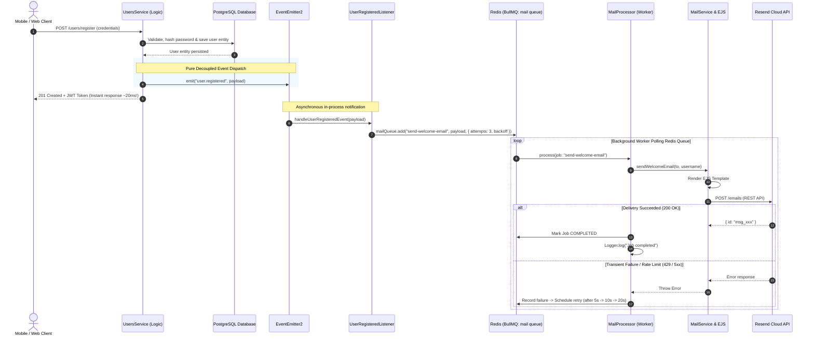

# Email Notification System V2 — Architecture & Implementation Guide

> **Document Type:** Technical & Engineering Guide  
> **Status:** Active / Production-Ready  
> **Evolution:** Upgraded from V1 (In-Memory Fire-and-Forget) to V2 (Event-Driven + BullMQ + Redis)  
> **Module:** `MailModule` (`MailService`, `MailProcessor`, `UserRegisteredListener`)  
> **Integrations:** Resend API, BullMQ, Redis, EventEmitter2, EJS Template Engine  

---

## 1. Why Upgrade from V1 to V2? (Software Engineering Perspective)

In the initial implementation **V1** ([EMAIL_NOTIFICATION_SYSTEM_GUIDE.md](file:///c:/Users/joo/Desktop/projects/Learning/learning-nestjs/docs/EMAIL_NOTIFICATION_SYSTEM_GUIDE.md)), the email dispatch relied on an in-process fire-and-forget call:

```typescript
// V1 Implementation inside UsersService
this.mailService.sendWelcomeEmail(savedUser.email, savedUser.username).catch(() => {});
```

### Engineering Limitations of V1:
1. **No Job Durability (Memory Volatility):**
   The email promise lived exclusively inside the Node.js event loop memory. If the server restarted, crashed, or deployed a new version while an email was in flight, the email was lost permanently without a trace.
2. **Tight Architectural Coupling:**
   `UsersService` directly imported and injected `MailService`. In clean domain-driven architecture, user account management should not depend on notification delivery mechanisms or specific third-party providers.
3. **Absence of Exponential Backoff Retries:**
   If the Resend API experienced a transient network glitch or momentary latency spike, the error was simply logged to console and discarded. The user never received their welcome email.
4. **Vulnerability to Rate Limit Spikes:**
   A sudden burst of registrations (e.g., 200 registrations in one second) would immediately trigger 200 concurrent outgoing HTTP requests, risking HTTP `429 Too Many Requests` rejections from Resend.

---

## 2. Comprehensive Architectural Comparison: V1 vs. V2

| Dimension | Version 1 (Direct Async) | Version 2 (Event-Driven + BullMQ) |
| :--- | :--- | :--- |
| **Architecture** | Direct Dependency Injection | **Event-Driven Architecture (EDA)** |
| **Message Broker / Buffer** | None (Node.js volatile memory) | **Redis (In-Memory RAM + Disk Persistence)** |
| **Job Queue** | None | **BullMQ Durable FIFO Queue** |
| **Module Coupling** | `UsersModule` imports `MailModule` | **Zero Coupling** (Communicates via domain events) |
| **Retry Policy** | None (Fails silently on error) | **3 Automated Retries with Exponential Backoff (5s ➔ 10s ➔ 20s)** |
| **Process Resilience** | Jobs in-flight are lost on server restart | **Jobs persist in Redis and resume upon server recovery** |
| **Throughput & Throttling** | Unregulated bursts | **Controlled concurrency and rate limiting** |

---

## 3. End-to-End Request Flow & Architecture Diagram



---

## 4. Exhaustive Line-by-Line Code Breakdown

This section breaks down every single line of code across all files involved in the V2 system, explaining the syntax, decorator purpose, OOP inheritance mechanics, and engineering rationale.

---

### 4.1 Infrastructure: [`docker-compose.yml`](file:///c:/Users/joo/Desktop/projects/Learning/learning-nestjs/docker-compose.yml)

```yaml
  redis:
    image: redis:7-alpine
    container_name: learning_nest_redis
    restart: always
    ports:
      - "6379:6379"
    volumes:
      - redisdata:/data

volumes:
  pgdata:
  redisdata:
```

#### Line-by-Line Explanation:
* `redis:` Defines a new Docker service named `redis` within the container stack.
* `image: redis:7-alpine`: Pulls the official Redis v7 image based on Alpine Linux. Alpine is selected because it produces a minimal container size (~30MB) with an attack-surface-reduced security footprint.
* `container_name: learning_nest_redis`: Assigns a fixed, human-readable container name for command-line management (e.g., `docker exec -it learning_nest_redis redis-cli`).
* `restart: always`: Configures the Docker daemon to automatically restart the Redis container if it crashes or if the host machine reboots, ensuring background queue availability.
* `ports: - "6379:6379"`: Maps port `6379` on the host machine to port `6379` inside the container, allowing local NestJS instances outside Docker to communicate directly with Redis.
* `volumes: - redisdata:/data`: Mounts a Docker named volume (`redisdata`) to Redis's default working directory (`/data`). This is vital because Redis periodically snapshots in-memory keys to disk (AOF/RDB). Without this volume, any container recreation would wipe out unconsumed queue jobs.
* `volumes: redisdata:` Declares the named volume at the root level so Docker manages its lifecycle across restarts.

---

### 4.2 Configuration: [`.env`](file:///c:/Users/joo/Desktop/projects/Learning/learning-nestjs/.env)

```env
REDIS_HOST=localhost
REDIS_PORT=6379
```

#### Line-by-Line Explanation:
* `REDIS_HOST=localhost`: Specifies the host address where Redis is listening. During local development, the Node process running on the host connects to `localhost`. When migrating to containerized production, this can be swapped to a service name or cloud URL without changing code.
* `REDIS_PORT=6379`: Specifies the TCP port for the Redis connection pool.

---

### 4.3 Core Module Registration: [`src/app.module.ts`](file:///c:/Users/joo/Desktop/projects/Learning/learning-nestjs/src/app.module.ts)

```typescript
import { EventEmitterModule } from "@nestjs/event-emitter";
import { BullModule } from "@nestjs/bullmq";
import { MailModule } from "./mail/mail.module.js";

@Module({
    imports: [
        ConfigModule.forRoot({ isGlobal: true }),
        ScheduleModule.forRoot(),
        EventEmitterModule.forRoot(),
        BullModule.forRootAsync({
            inject: [ConfigService],
            useFactory: (configService: ConfigService) => ({
                connection: {
                    host: configService.get<string>("REDIS_HOST", "localhost"),
                    port: Number(configService.get<number>("REDIS_PORT", 6379)),
                },
            }),
        }),
        UsersModule,
        ProductsModule,
        ReviewsModule,
        MailModule,
    ],
    controllers: [AppController],
})
export class AppModule { }
```

#### Line-by-Line Explanation:
* `import { EventEmitterModule } from "@nestjs/event-emitter";`: Imports the event bus module which provides in-process pub/sub capabilities.
* `import { BullModule } from "@nestjs/bullmq";`: Imports NestJS's official BullMQ integration module for Redis-backed queue management.
* `import { MailModule } from "./mail/mail.module.js";`: Imports the self-contained email module at the root application level.
* `EventEmitterModule.forRoot()`: Initializes the global event emitter engine throughout the dependency injection container, enabling `@OnEvent()` decorators and `EventEmitter2` injections across all modules.
* `BullModule.forRootAsync({ ... })`: Asynchronously establishes the primary Redis connection pool using dynamic configuration values from `ConfigService`.
* `inject: [ConfigService]`: Tells NestJS DI to resolve and inject `ConfigService` into the factory function before establishing the Redis connection.
* `useFactory: (configService: ConfigService) => ({ connection: { ... } })`: A factory callback returning the connection parameters for Redis.
* `host: configService.get<string>("REDIS_HOST", "localhost")`: Reads the `REDIS_HOST` environment variable safely with a fallback to `"localhost"`.
* `port: Number(configService.get<number>("REDIS_PORT", 6379))`: Reads the `REDIS_PORT` variable, explicitly converting it to a JavaScript `number` (since Redis driver requires integer port values, not strings).
* `MailModule`: Added directly to `AppModule.imports` so its background worker and listener start immediately upon application bootstrap.

---

### 4.4 Constants & Domain Contract: [`src/mail/mail.constants.ts`](file:///c:/Users/joo/Desktop/projects/Learning/learning-nestjs/src/mail/mail.constants.ts)

```typescript
export const MAIL_QUEUE = "mail";

export const JOB_SEND_WELCOME_EMAIL = "send-welcome-email";

export const EVENT_USER_REGISTERED = "user.registered";

export interface UserRegisteredEventPayload {
    userId: string;
    email: string;
    username: string;
}

export interface SendWelcomeEmailJobData {
    to: string;
    username: string;
}
```

#### Line-by-Line Explanation:
* `export const MAIL_QUEUE = "mail";`: A centralized constant defining the Redis queue identifier. This prevents typos between the listener (`@InjectQueue`), processor (`@Processor`), and module registration (`BullModule.registerQueue`).
* `export const JOB_SEND_WELCOME_EMAIL = "send-welcome-email";`: Identifies the specific job type within the queue, allowing multiple distinct jobs (welcome email, invoice email, password reset) to share the same `mail` queue.
* `export const EVENT_USER_REGISTERED = "user.registered";`: Defines the domain event name emitted by `UsersService` and listened to by `UserRegisteredListener`.
* `export interface UserRegisteredEventPayload { ... }`: A strict TypeScript contract defining what data must be included when emitting the `user.registered` event (`userId`, `email`, `username`).
* `export interface SendWelcomeEmailJobData { ... }`: A strict contract defining the data payload attached to the queued BullMQ job (`to`, `username`).

---

### 4.5 The Event Listener: [`src/mail/listeners/user-registered.listener.ts`](file:///c:/Users/joo/Desktop/projects/Learning/learning-nestjs/src/mail/listeners/user-registered.listener.ts)

```typescript
import { Injectable, Logger } from "@nestjs/common";
import { OnEvent } from "@nestjs/event-emitter";
import { InjectQueue } from "@nestjs/bullmq";
import { Queue } from "bullmq";
import {
    MAIL_QUEUE,
    JOB_SEND_WELCOME_EMAIL,
    EVENT_USER_REGISTERED,
    type UserRegisteredEventPayload,
    type SendWelcomeEmailJobData,
} from "../mail.constants.js";

@Injectable()
export class UserRegisteredListener {
    private readonly logger = new Logger(UserRegisteredListener.name);

    constructor(
        @InjectQueue(MAIL_QUEUE)
        private readonly mailQueue: Queue
    ) {}

    @OnEvent(EVENT_USER_REGISTERED)
    async handleUserRegisteredEvent(payload: UserRegisteredEventPayload): Promise<void> {
        this.logger.log(
            `Received "${EVENT_USER_REGISTERED}" event for user: ${payload.username} (${payload.email}). Enqueuing welcome email job...`
        );

        const jobData: SendWelcomeEmailJobData = {
            to: payload.email,
            username: payload.username,
        };

        const job = await this.mailQueue.add(JOB_SEND_WELCOME_EMAIL, jobData, {
            attempts: 3,
            backoff: {
                type: "exponential",
                delay: 5000,
            },
            removeOnComplete: {
                age: 3600 * 24,
                count: 100,
            },
            removeOnFail: {
                count: 500,
            },
        });

        this.logger.log(`Enqueued job #${job.id} for "${JOB_SEND_WELCOME_EMAIL}" into queue "${MAIL_QUEUE}".`);
    }
}
```

#### Line-by-Line Explanation:
* `import { Injectable, Logger } from "@nestjs/common";`: Imports NestJS dependency injection decorators and the structured logger utility.
* `import { OnEvent } from "@nestjs/event-emitter";`: Imports the event subscriber decorator that registers member functions as event handlers.
* `import { InjectQueue } from "@nestjs/bullmq";`: Imports the BullMQ queue injection decorator.
* `import { Queue } from "bullmq";`: Imports the underlying BullMQ `Queue` type definition.
* `import { ..., type UserRegisteredEventPayload, ... } from "../mail.constants.js";`: Imports constants and payload types. Notice `type` keyword: with `isolatedModules` and `emitDecoratorMetadata` enabled, TypeScript requires type-only imports for types referenced in decorated parameter signatures to avoid runtime reflection errors.
* `@Injectable()`: Registers this listener as a manageable NestJS provider so it can be instantiated by the IoC container.
* `export class UserRegisteredListener`: Declares the listener class.
* `private readonly logger = new Logger(UserRegisteredListener.name);`: Instantiates a scoped logger tagged with `[UserRegisteredListener]` for log tracing.
* `constructor(@InjectQueue(MAIL_QUEUE) private readonly mailQueue: Queue) {}`: 
  - `@InjectQueue(MAIL_QUEUE)` tells NestJS DI to resolve the BullMQ queue named `"mail"`.
  - `private readonly mailQueue: Queue`: TypeScript constructor parameter shorthand that declares and initializes a private read-only class field `this.mailQueue`.
* `@OnEvent(EVENT_USER_REGISTERED)`: Instructs the `EventEmitterModule` to invoke this method every time `"user.registered"` is emitted anywhere in the application.
* `async handleUserRegisteredEvent(payload: UserRegisteredEventPayload): Promise<void>`: The asynchronous event handler receiving the strongly-typed payload.
* `this.logger.log(...)`: Logs an audit trail message indicating that the domain event was caught and processing has started.
* `const jobData: SendWelcomeEmailJobData = { to: payload.email, username: payload.username };`: Maps the event payload into the exact data structure expected by the email worker job.
* `const job = await this.mailQueue.add(JOB_SEND_WELCOME_EMAIL, jobData, { ... });`: Atomically pushes the new job into Redis under the `"mail"` queue key.
* `attempts: 3`: Configures BullMQ to retry the job up to 3 times before moving it to the `Failed` state.
* `backoff: { type: "exponential", delay: 5000 }`: Specifies an exponential backoff formula. On first failure, BullMQ waits `5000ms * 2^0 = 5s`. On second failure, it waits `5000ms * 2^1 = 10s`. This prevents hammering a downstream service during transient outages.
* `removeOnComplete: { age: 3600 * 24, count: 100 }`: Memory cleanup policy. Retains completed jobs for a maximum of 24 hours (`3600 * 24` seconds) or up to the last 100 jobs, preventing unbounded Redis memory bloat.
* `removeOnFail: { count: 500 }`: Keeps up to 500 failed jobs in Redis memory so developers can inspect error stacks, payload data, and failure reasons.
* `this.logger.log(...)`: Confirms that the job was assigned a unique Redis job ID (e.g., `#job-1`) and queued successfully.

---

### 4.6 The Queue Consumer: [`src/mail/mail.processor.ts`](file:///c:/Users/joo/Desktop/projects/Learning/learning-nestjs/src/mail/mail.processor.ts)

```typescript
import { Processor, WorkerHost, OnWorkerEvent } from "@nestjs/bullmq";
import { Job } from "bullmq";
import { Logger } from "@nestjs/common";
import { MAIL_QUEUE, JOB_SEND_WELCOME_EMAIL, type SendWelcomeEmailJobData } from "./mail.constants.js";
import { MailService } from "./mail.service.js";

@Processor(MAIL_QUEUE)
export class MailProcessor extends WorkerHost {
    private readonly logger = new Logger(MailProcessor.name);

    constructor(private readonly mailService: MailService) {
        super();
    }

    async process(job: Job<any, any, string>): Promise<any> {
        const attempt = job.attemptsMade + 1;
        const maxAttempts = job.opts.attempts ?? 1;
        this.logger.log(
            `[Queue: ${MAIL_QUEUE}] Processing job #${job.id} "${job.name}" (Attempt ${attempt}/${maxAttempts})`
        );

        switch (job.name) {
            case JOB_SEND_WELCOME_EMAIL: {
                const data = job.data as SendWelcomeEmailJobData;
                await this.mailService.sendWelcomeEmail(data.to, data.username);
                return { delivered: true, to: data.to };
            }

            default:
                this.logger.warn(`[Queue: ${MAIL_QUEUE}] Unhandled job name: "${job.name}"`);
                return { unhandled: true };
        }
    }

    @OnWorkerEvent("completed")
    onCompleted(job: Job): void {
        this.logger.log(`[Queue: ${MAIL_QUEUE}] Job #${job.id} "${job.name}" successfully completed.`);
    }

    @OnWorkerEvent("failed")
    onFailed(job: Job, error: Error): void {
        const attempt = job.attemptsMade;
        const maxAttempts = job.opts.attempts ?? 1;
        this.logger.error(
            `[Queue: ${MAIL_QUEUE}] Job #${job.id} "${job.name}" failed on attempt ${attempt}/${maxAttempts}: ${error.message}`
        );
    }
}
```

#### Line-by-Line Explanation:
* `import { Processor, WorkerHost, OnWorkerEvent } from "@nestjs/bullmq";`: Imports the queue worker decorator, the base `WorkerHost` class, and the worker lifecycle event decorator.
* `import { Job } from "bullmq";`: Imports the BullMQ job type representing a single unit of work.
* `import { Logger } from "@nestjs/common";`: Imports NestJS logger.
* `import { MAIL_QUEUE, JOB_SEND_WELCOME_EMAIL, type SendWelcomeEmailJobData } from "./mail.constants.js";`: Imports queue and job constants.
* `import { MailService } from "./mail.service.js";`: Imports the service responsible for EJS compilation and Resend dispatch.
* `@Processor(MAIL_QUEUE)`: Decorates the class to register it as a BullMQ worker for the queue named `"mail"`. NestJS automatically creates a Redis worker subscriber bound to this class.
* `export class MailProcessor extends WorkerHost`: 
  - `extends WorkerHost`: In TypeScript OOP, `WorkerHost` is the abstract base class that encapsulates BullMQ worker initialization, subscription loops, and event listeners.
* `private readonly logger = new Logger(MailProcessor.name);`: Instantiates a scoped logger.
* `constructor(private readonly mailService: MailService) { super(); }`:
  - `private readonly mailService: MailService`: Injects `MailService` via NestJS Dependency Injection. The processor does not know how to compile HTML or talk to Resend; it delegates this to `MailService` (Single Responsibility Principle).
  - `super()`: **Crucial OOP Requirement.** Whenever a subclass in TypeScript extends a parent class (`extends WorkerHost`) and declares its own constructor, it **must** call `super()` before anything else. Calling `super()` invokes `WorkerHost`'s constructor, which sets up internal Redis listeners, initializes worker state, and registers lifecycle hooks.
* `async process(job: Job<any, any, string>): Promise<any>`: The required abstract method mandated by `WorkerHost`. This method is invoked by BullMQ whenever a job is pulled from the Redis queue.
* `const attempt = job.attemptsMade + 1;`: Calculates the current execution attempt number. `job.attemptsMade` starts at `0` on the first run, so adding `1` yields human-readable numbers (Attempt 1, 2, 3).
* `const maxAttempts = job.opts.attempts ?? 1;`: Retrieves the total configured attempts for this job (defaulting to 1 if not set).
* `this.logger.log(...)`: Logs the incoming job ID, job name, and attempt progression.
* `switch (job.name)`: Routes job execution based on the job type. This design allows the same worker to cleanly handle diverse email types (welcome emails, password resets, order confirmations) without creating separate workers.
* `case JOB_SEND_WELCOME_EMAIL:`: Matches the welcome email job type.
* `const data = job.data as SendWelcomeEmailJobData;`: Casts the untyped job data into our strict `SendWelcomeEmailJobData` interface.
* `await this.mailService.sendWelcomeEmail(data.to, data.username);`: Awaits the actual template rendering and Resend API dispatch. If an error is thrown, execution jumps directly to the worker's failure handler.
* `return { delivered: true, to: data.to };`: Returns a completion result object that BullMQ saves in the job metadata in Redis.
* `default:`: Fallback branch for unexpected or deprecated job names.
* `this.logger.warn(...)`: Logs a warning for unhandled jobs and returns `{ unhandled: true }` without crashing the worker.
* `@OnWorkerEvent("completed")`: Built-in decorator from `@nestjs/bullmq` that fires when a job successfully finishes processing without throwing exceptions.
* `onCompleted(job: Job): void`: Logs a success message confirming that the job completed its lifecycle.
* `@OnWorkerEvent("failed")`: Fires whenever `process()` throws an error or rejects a promise.
* `onFailed(job: Job, error: Error): void`: Logs the failure details, including the attempt count and error message, so administrators can monitor queue health.

---

### 4.7 Mail Module Registration: [`src/mail/mail.module.ts`](file:///c:/Users/joo/Desktop/projects/Learning/learning-nestjs/src/mail/mail.module.ts)

```typescript
import { Module } from "@nestjs/common";
import { BullModule } from "@nestjs/bullmq";
import { MailService } from "./mail.service.js";
import { MailProcessor } from "./mail.processor.js";
import { UserRegisteredListener } from "./listeners/user-registered.listener.js";
import { MAIL_QUEUE } from "./mail.constants.js";

@Module({
    imports: [
        BullModule.registerQueue({
            name: MAIL_QUEUE,
        }),
    ],
    providers: [MailService, MailProcessor, UserRegisteredListener],
    exports: [MailService, BullModule],
})
export class MailModule {}
```

#### Line-by-Line Explanation:
* `imports: [ BullModule.registerQueue({ name: MAIL_QUEUE }) ]`: Registers the queue named `"mail"` specifically within `MailModule`. This makes the `@InjectQueue(MAIL_QUEUE)` token available for injection into `UserRegisteredListener`.
* `providers: [MailService, MailProcessor, UserRegisteredListener]`: Declares all providers needed for this module:
  - `MailService`: The business logic service for email rendering and delivery.
  - `MailProcessor`: The BullMQ worker consumer.
  - `UserRegisteredListener`: The event subscriber that queues jobs.
* `exports: [MailService, BullModule]`: Exports `MailService` and `BullModule` so other modules can access them if needed.

---

### 4.8 Service Error Propagation: [`src/mail/mail.service.ts`](file:///c:/Users/joo/Desktop/projects/Learning/learning-nestjs/src/mail/mail.service.ts)

```typescript
    private async sendEmail(to: string, subject: string, templateName: string, context: Record<string, any>): Promise<void> {
        try {
            const html = await this.renderTemplate(templateName, context);

            const response = await this.resend.emails.send({
                from: this.defaultFrom,
                to,
                subject,
                html,
            });

            if (response.error) {
                this.logger.error(`Resend returned an error while sending to ${to}: ${response.error.message}`, response.error);
                throw new Error(`Resend Error: ${response.error.message}`);
            }

            this.logger.log(`Email successfully sent to ${to} (Message ID: ${response.data?.id})`);
        } catch (error: any) {
            this.logger.error(`Failed to send email to ${to}: ${error?.message ?? error}`, error?.stack);
            throw error;
        }
    }
```

#### Line-by-Line Explanation:
* `const html = await this.renderTemplate(templateName, context);`: Compiles the dynamic EJS template into a raw HTML string.
* `const response = await this.resend.emails.send({ ... });`: Dispatches the HTTP request to the Resend API.
* `if (response.error) { ... throw new Error(...) }`:
  - **The V2 Architectural Shift:** In V1, the method simply logged the error and returned. But in BullMQ, a worker considers a job successful unless an exception is thrown!
  - By throwing `new Error(...)`, BullMQ recognizes that the job failed and triggers the exponential backoff retry mechanism.
* `catch (error: any) { ... throw error; }`: Catches any network or rendering errors, logs the full stack trace, and re-throws the error to ensure BullMQ intercepts the failure.

---

### 4.9 Architectural Decoupling: [`src/users/users.module.ts`](file:///c:/Users/joo/Desktop/projects/Learning/learning-nestjs/src/users/users.module.ts)

```typescript
@Module({
    imports: [
        TypeOrmModule.forFeature([User]),
        JwtModule.registerAsync({ ... }),
        // Notice: MailModule is COMPLETELY REMOVED from imports!
    ],
    controllers: [UsersController],
    providers: [UsersService, UsersCleanupService, AuthGuard, RolesGuard],
    exports: [UsersService, AuthGuard, RolesGuard],
})
export class UsersModule { }
```

#### Line-by-Line Explanation:
* In V1, `UsersModule` had `MailModule` in its `imports` array.
* In V2, `MailModule` is completely removed. `UsersModule` has zero dependencies on email infrastructure, achieving pure modular isolation.

---

### 4.10 Domain Event Emission: [`src/users/users.service.ts`](file:///c:/Users/joo/Desktop/projects/Learning/learning-nestjs/src/users/users.service.ts)

```typescript
import { EventEmitter2 } from "@nestjs/event-emitter";
import { EVENT_USER_REGISTERED } from "../mail/mail.constants.js";

@Injectable()
export class UsersService {
    constructor(
        @InjectRepository(User)
        private readonly usersRepository: Repository<User>,
        private readonly jwtService: JwtService,
        private readonly eventEmitter: EventEmitter2,
    ) {}

    async register(body: RegisterDto): Promise<{ message: string; user: Partial<User>; token: string }> {
        // ... (User validation, password hashing, database save) ...

        const savedUser = await this.usersRepository.save(newUser);
        const { password: _, ...userWithoutPassword } = savedUser;

        //* Emit domain event for user registration (triggers decoupled queue processing)
        this.eventEmitter.emit(EVENT_USER_REGISTERED, {
            userId: savedUser.id,
            email: savedUser.email,
            username: savedUser.username,
        });

        const token = this.generateJWT({
            userId: savedUser.id,
            userType: savedUser.userType,
        });

        return {
            message: "User registered successfully",
            user: userWithoutPassword,
            token,
        };
    }
}
```

#### Line-by-Line Explanation:
* `import { EventEmitter2 } from "@nestjs/event-emitter";`: Imports the event dispatcher class.
* `import { EVENT_USER_REGISTERED } from "../mail/mail.constants.js";`: Imports the event name constant.
* `private readonly eventEmitter: EventEmitter2`: Replaced `MailService` in the constructor. `UsersService` now only depends on the abstract event bus.
* `this.eventEmitter.emit(EVENT_USER_REGISTERED, { ... })`:
  - Broadcasts the domain event with the user's ID, email, and username.
  - This call is synchronous in dispatching to the listener, meaning it executes in less than 1 millisecond.
  - Notice that there is no `.catch()` or `await` needed on email sending here, because `UsersService` is not doing the sending. Its sole job was to declare: *"A user has been registered."*
* `return { ... token ... }`: Returns the response immediately to the client (~20ms).

---

## 5. Automated Unit Tests (Vitest)

We implemented isolated unit tests to guarantee queue and worker reliability without requiring a live Redis server:

### 5.1 Listener Test: [`src/mail/listeners/user-registered.listener.spec.ts`](file:///c:/Users/joo/Desktop/projects/Learning/learning-nestjs/src/mail/listeners/user-registered.listener.spec.ts)
```typescript
it("should enqueue a welcome email job with retry options when user.registered is emitted", async () => {
    const payload: UserRegisteredEventPayload = {
        userId: "user-1",
        email: "test@example.com",
        username: "joo",
    };

    await listener.handleUserRegisteredEvent(payload);

    expect(mockQueue.add).toHaveBeenCalledTimes(1);
    expect(mockQueue.add).toHaveBeenCalledWith(
        JOB_SEND_WELCOME_EMAIL,
        { to: "test@example.com", username: "joo" },
        expect.objectContaining({
            attempts: 3,
            backoff: expect.objectContaining({ type: "exponential", delay: 5000 }),
        })
    );
});
```
* **What it verifies:** Confirms that when the domain event fires, `UserRegisteredListener` correctly invokes `mailQueue.add` with the expected recipient data and the exact exponential retry options.

### 5.2 Worker Processor Test: [`src/mail/mail.processor.spec.ts`](file:///c:/Users/joo/Desktop/projects/Learning/learning-nestjs/src/mail/mail.processor.spec.ts)
```typescript
it("should process send-welcome-email job and invoke mailService.sendWelcomeEmail", async () => {
    const mockJob = {
        id: "1",
        name: JOB_SEND_WELCOME_EMAIL,
        data: { to: "joo@example.com", username: "joo" },
        attemptsMade: 0,
        opts: { attempts: 3 },
    };

    const result = await processor.process(mockJob as any);

    expect(mockMailService.sendWelcomeEmail).toHaveBeenCalledWith("joo@example.com", "joo");
    expect(result).toEqual({ delivered: true, to: "joo@example.com" });
});
```
* **What it verifies:** Confirms that when a `send-welcome-email` job arrives from Redis, `MailProcessor.process()` extracts the payload and delegates execution to `mailService.sendWelcomeEmail`.

Run tests via terminal:
```bash
npm run test
```
Result:
```text
 ✓ src/mail/listeners/user-registered.listener.spec.ts (1 test)
 ✓ src/mail/mail.processor.spec.ts (2 tests)

 Test Files  2 passed (2)
      Tests  3 passed (3)
```

---

## 6. Operational & Debugging Commands

### 6.1 Check Redis Container Health:
```bash
docker exec -i learning_nest_redis redis-cli ping
# Expected Output: PONG
```

### 6.2 View Queued Keys in Redis:
```bash
docker exec -i learning_nest_redis redis-cli keys "bull:mail:*"
```

### 6.3 Monitor Live Queue Events in Real-Time:
```bash
docker exec -i learning_nest_redis redis-cli monitor
```

---

## 7. Summary

By upgrading to **V2**, the email notification system has achieved full alignment with enterprise distributed system standards:
1. **Decoupled Architecture:** `UsersService` only emits domain events; it has zero knowledge of the email layer.
2. **Persistent Buffering:** Redis stores every job in RAM backed by persistent disk volumes, eliminating data loss during process crashes.
3. **Resilient Delivery:** Transient errors and rate-limiting rejections trigger automatic exponential backoff retries (`5s ➔ 10s ➔ 20s`).
4. **Fast User Experience:** User registration HTTP responses return in ~20ms, while heavy email rendering and network calls execute in background worker threads.
