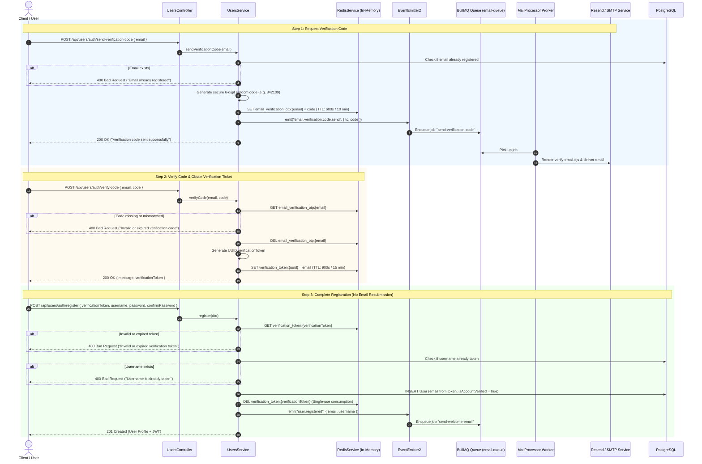

# Email Verification (Pre-Registration Flow) System Guide

## 1. Overview & Architectural Motivation

In modern web applications, user registration requires ensuring that the email provided is valid, accessible, and owned by the registering user.

There are two primary architectural patterns for email verification:
1. **Post-Registration Verification:** The user account is immediately persisted into the database with `isAccountVerified: false`, and an activation email is sent containing an activation link or code.
2. **Pre-Registration Verification with Verification Tickets (Implemented):** The user proves ownership of their email address **before** their account record is created in the database, receiving a cryptographically random, single-use `verificationToken` that binds the verified email to the subsequent registration step.

### Why Pre-Registration Flow with Verification Tokens?
- **Zero Database Pollution:** Prevents bots and malicious users from filling the PostgreSQL database with abandoned or unverified accounts.
- **Superior User Experience (No Redundant Inputs):** The client enters their email once to verify it. Upon entering the correct OTP, the server returns a `verificationToken`. The client never has to re-type or resend their email during the registration step.
- **Anti-Tampering Security:** Eliminates email spoofing/tampering between steps (e.g. verifying `alice@example.com` but submitting `bob@example.com` in registration). The server resolves the email directly from the server-side Redis token.
- **Optimized Database Queries:** In the registration step, the database query only needs to verify username uniqueness (`where: { username }`), eliminating redundant email queries.
- **Temporary State Offloaded to Redis:** Ephemeral verification state and short-lived OTP tokens live in fast in-memory Redis keys with automatic expiration (TTL), removing the need for manual DB cleanup tables.

---

## 2. The 3-Step Pre-Registration Flow



---

## 3. Endpoints & DTO Contracts

### 3.1 Send Verification Code
- **Method & Route:** `POST /api/users/auth/send-verification-code`
- **Request Body:**
  ```json
  {
    "email": "user@example.com"
  }
  ```
- **DTO Validation:**
  - `email`: Required, valid email format via `@IsEmail()`.
- **Response:**
  ```json
  {
    "message": "Verification code sent successfully to your email. It expires in 10 minutes."
  }
  ```

### 3.2 Verify Code
- **Method & Route:** `POST /api/users/auth/verify-code`
- **Request Body:**
  ```json
  {
    "email": "user@example.com",
    "code": "842109"
  }
  ```
- **DTO Validation:**
  - `email`: Required, valid email format.
  - `code`: Exactly 6 digits (`@Length(6, 6)`, `@IsNotEmpty()`).
- **Response:**
  ```json
  {
    "message": "Email verified successfully. You can now complete your registration.",
    "verificationToken": "3fa85f64-5717-4562-b3fc-2c963f66afa6"
  }
  ```

### 3.3 Complete Registration
- **Method & Route:** `POST /api/users/auth/register`
- **Request Body:**
  ```json
  {
    "verificationToken": "3fa85f64-5717-4562-b3fc-2c963f66afa6",
    "username": "johndoe",
    "password": "StrongPassword123!",
    "confirmPassword": "StrongPassword123!"
  }
  ```
- **DTO Validation:**
  - `verificationToken`: Required string.
  - `username`: Required string, length between 3 and 30 characters.
  - `password`: Required string, minimum length 6 characters.
  - `confirmPassword`: Must match `password` via `@Match()`.
- **Response:**
  ```json
  {
    "message": "User registered successfully",
    "user": {
      "id": "e80d1872-6c81-4fcd-ae25-47528d763aae",
      "username": "johndoe",
      "email": "user@example.com",
      "userType": "user",
      "isAccountVerified": true,
      "profileImage": null,
      "createdAt": "2026-10-14T20:00:00.000Z",
      "updatedAt": "2026-10-14T20:00:00.000Z",
      "deletedByAdmin": false,
      "deletedAt": null
    },
    "token": "eyJhbGciOiJIUzI1NiIsInR5cCI..."
  }
  ```

---

## 4. Redis Key Lifecycle & Expiration (TTL)

| Key Pattern | Purpose | Value | TTL | Lifecycle |
| :--- | :--- | :--- | :--- | :--- |
| `email_verification_otp:<email>` | Stores the 6-digit OTP code | e.g. `"842109"` | **600s (10 min)** | Generated in Step 1. Deleted immediately upon successful verification in Step 2. Auto-expires if abandoned. |
| `verification_token:<uuid>` | Single-use registration ticket holding verified email | e.g. `"user@example.com"` | **900s (15 min)** | Generated in Step 2 upon valid OTP. Consumed and deleted immediately during Step 3 registration to prevent token replay. |

---

## 5. Event-Driven & Queue Integration

The verification system leverages the existing asynchronous pipeline:
1. **Event Name:** `email.verification.code.send` (`EVENT_SEND_VERIFICATION_CODE`)
2. **Payload:** `{ to: string, code: string }`
3. **Queue Job:** `send-verification-code` (`JOB_SEND_VERIFICATION_CODE`)
4. **Retry Policy:** 3 attempts with exponential backoff (initial delay: 5000ms).
5. **Template:** `src/mail/templates/verify-email.ejs` (renders a clean modern card with large digits and security tips).

---

## 6. How to Test with cURL

### 1. Request Code
```bash
curl -X POST http://localhost:3000/api/users/auth/send-verification-code \
  -H "Content-Type: application/json" \
  -d '{"email":"testuser@example.com"}'
```

### 2. Verify Code & Obtain Token
```bash
curl -X POST http://localhost:3000/api/users/auth/verify-code \
  -H "Content-Type: application/json" \
  -d '{"email":"testuser@example.com", "code":"123456"}'
```
*Output contains `"verificationToken": "<TOKEN_UUID>"`, e.g. `"3fa85f64-5717-4562-b3fc-2c963f66afa6"`.*

### 3. Register (Without Typing Email)
```bash
curl -X POST http://localhost:3000/api/users/auth/register \
  -H "Content-Type: application/json" \
  -d '{
    "verificationToken": "3fa85f64-5717-4562-b3fc-2c963f66afa6",
    "username": "testuser",
    "password": "Password123!",
    "confirmPassword": "Password123!"
  }'
```
