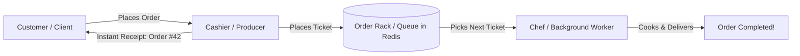
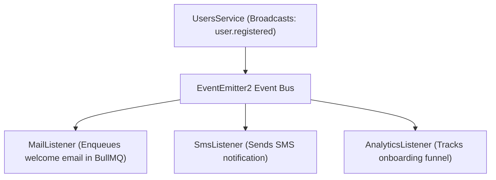

# Redis, BullMQ & Event-Driven Architecture — Conceptual Guide

> **Document Type:** Conceptual & Engineering Primer  
> **Target Audience:** Developers new to Distributed Systems, Message Brokers, and Event-Driven Design  
> **Status:** Active  
> **Subject:** Redis, Message Queues (BullMQ), and Event-Driven Architecture explained simply  

---

## 1. Introduction: Why Traditional Direct Calls Fall Short

In basic web applications, when a user triggers an action (such as registration or placing an order), servers typically execute tasks sequentially (Synchronously):
1. Save the record in the database.
2. Send a welcome email via an external service.
3. Send a push notification.
4. Issue reward points.
5. Return an HTTP `201 Created` / `200 OK` response.

```text
[HTTP Request] ──> [Save to DB] ──> [Send Email (2s)] ──> [Send Push (1s)] ──> [HTTP Response (3s+ total)]
```

### Critical Flaws in this Approach:
1. **High Latency (Sluggish User Experience):** The client must wait for every third-party network call to complete before receiving a response.
2. **Cascading Failures:** If the external email service suffers a temporary network timeout, the entire user registration transaction fails!
3. **Tight Architectural Coupling:** `UsersService` becomes bloated, directly depending on `MailService`, `NotificationService`, and `AnalyticsService`.

To solve these problems in enterprise-grade applications, we utilize three architectural pillars:
- **Redis (In-Memory Data Store)**
- **Message Queues (BullMQ)**
- **Event-Driven Architecture (EventEmitter2)**

---

## 2. What is Redis? (And Why Do We Need It?)

### 2.1 The Core Concept
**Redis** (**RE**mote **DI**ctionary **S**erver) is an open-source, in-memory data store that keeps data in **RAM** rather than writing primarily to disk (HDD/SSD).

```text
Traditional Database (PostgreSQL):
[Request] ──> [Disk I/O (Hard Drive / SSD)] ──> Millisecond latency (comparatively slow)

Redis Database:
[Request] ──> [RAM Memory Operations]       ──> Nanosecond / Microsecond latency (ultra fast)
```

### 2.2 Common Question: "Why not just use an in-memory JavaScript array `const queue = []` in Node.js?"
1. **Process Restarts & Crashes:** If the Node.js application restarts, crashes, or is redeployed with new code, all jobs in a plain JavaScript array disappear instantly.
2. **Horizontal Scaling (Multi-Instance Systems):** When running multiple server instances (e.g., 3 Node.js containers behind a load balancer), each instance has its own isolated RAM. They cannot share a local in-memory array. **Redis acts as a centralized shared state** accessible by all instances.
3. **Disk Persistence (RDB & AOF):** Even though Redis stores data in RAM, it regularly persists snapshots to disk. If the server loses power, Redis restores jobs from disk upon reboot without data loss.

---

## 3. What is a Message Queue?

### 3.1 The Restaurant Analogy
Imagine a busy restaurant:
- **The Cashier (Producer):** Takes an order from the customer, prints a ticket (Job), pegs it onto the order rack (Queue), and immediately turns to serve the next customer. This step takes only 5 seconds.
- **The Kitchen Rack (Queue):** Holds orders in a First-In, First-Out (FIFO) sequence.
- **The Chef (Worker / Consumer):** Picks up the next ticket from the rack, prepares the dish at a steady pace, and marks it finished.



* **Without a Queue:** The cashier would have to walk into the kitchen, cook the meal personally for 20 minutes while the customer waits at the register, completely blocking other customers from placing orders!

---

## 4. What is BullMQ?

**BullMQ** is the leading NodeJS & TypeScript message queue library built on top of **Redis**. It provides queue management, distributed job processing, and background worker coordination.

### Key BullMQ Terminology:

| Term | Engineering Definition | Real-World Analogy |
| :--- | :--- | :--- |
| **Queue** | A named Redis channel where jobs are buffered and ordered. | The kitchen order rack or postal drop box. |
| **Job** | An individual unit of work containing payload data (e.g., `{ to: "user@test.com", username: "alex" }`). | The printed order ticket or mail envelope. |
| **Producer** | The code that dispatches a job to the queue (`mailQueue.add(...)`). | The cashier who posts the ticket. |
| **Worker / Processor** | The background process that fetches and executes jobs from the queue. | The chef who prepares the meal. |

### Powerful BullMQ Features:

#### A. Automated Exponential Backoff Retries
If sending an email fails due to a temporary outage or rate limit on the external provider:
* Instead of throwing an unhandled error and dropping the email, BullMQ automatically schedules retries:
  - **Attempt 1:** Fails ➔ Waits 5 seconds.
  - **Attempt 2:** Fails ➔ Waits 10 seconds.
  - **Attempt 3:** Succeeds ➔ Job marked completed!
* This gives downstream services time to recover without dropping user notifications.

#### B. Rate Limiting & Concurrency Control
If 10,000 users sign up within a few minutes during a marketing campaign:
* BullMQ safely enqueues all 10,000 jobs into Redis within milliseconds.
* The worker processes them at a controlled rate (e.g., 5 jobs per second) so you never exceed third-party API rate limits (`429 Too Many Requests`).

---

## 5. What is Event-Driven Architecture (EDA)?

### 5.1 The Concept of an "Event"
An **Event** is an announcement that **something has already occurred in the past** within your domain:
- `user.registered` (A user just created an account)
- `order.placed` (An order was completed)
- `invoice.generated` (A billing invoice was created)

### 5.2 Direct Invocation vs. Event-Driven Decoupling

#### Traditional Tight Coupling:
```typescript
// UsersService
await this.mailService.sendWelcomeEmail(...);
await this.smsService.sendWelcomeSMS(...);
await this.crmService.syncUser(...);
```
> **Problem:** `UsersService` must know about every downstream consumer. Modifying email logic risks breaking the registration workflow.

#### Event-Driven Decoupling:
```typescript
// UsersService
this.eventEmitter.emit("user.registered", { userId, email, username });
```
> `UsersService` merely broadcasts what happened. It does not know or care who listens to the event or what actions they take!



Each listener resides in its own isolated module. You can introduce new listeners (e.g., Discord alerts, CRM sync) at any time without altering a single line of code in `UsersService`.

---

## 6. How the Entire Pipeline Works Together

```text
[ Client Submits Registration Form ]
               │
               ▼
1. UsersService ─────(1) Saves user in PostgreSQL database
               │
               ▼
2. EventEmitter ─────(2) Emits "user.registered" domain event
               │
               ▼
3. MailListener ─────(3) Catches event & enqueues job into Redis via BullMQ
               │
               ▼
4. Redis Storage ────(4) Persists job securely in memory (RAM + Disk)
               │
               ▼
5. MailProcessor ────(5) Worker pulls job in the background and sends via Resend
               │
               ▼
   (If Resend fails? ──> BullMQ automatically retries after 5s, then 10s, then 20s)
```

With this architecture in place, your application achieves the reliability, fault tolerance, and loose coupling practiced by engineering teams at scale.
