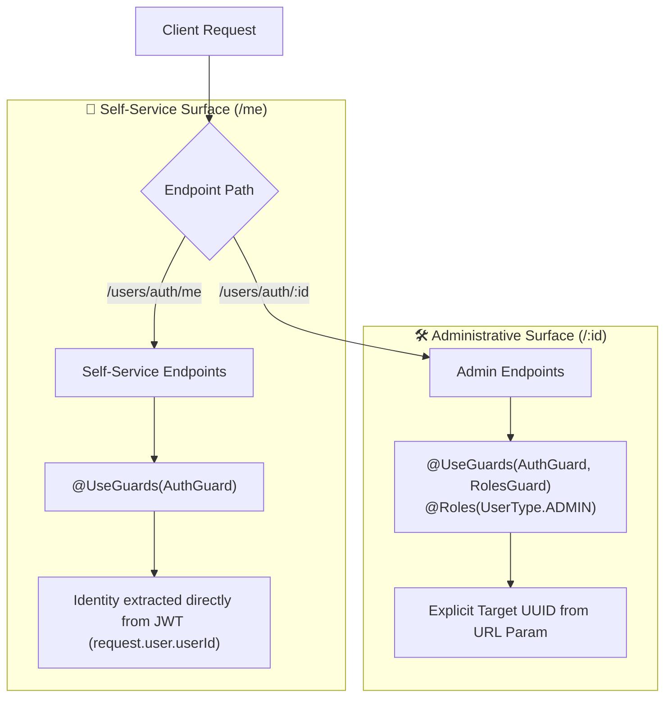

# Architectural Decision Record: Separating Self-Service (`/me`) from Administrative (`/:id`) Routes

> **Document Type:** Architectural Decision Record (ADR)  
> **Status:** Accepted & Implemented  
> **Scope:** RESTful API Design, Access Control Architecture, User Profile & Management  

---

## 1. Context & Problem Statement

In many early-stage API designs, developers attempt to handle both **user self-management** and **administrative user management** using a single parameterized route:

```typescript
// ❌ The Overloaded / Anti-Pattern Approach
PUT    /users/auth/:id
DELETE /users/auth/:id
```

In this naive pattern:
- A regular user sends their own UUID in the URL parameter (`/users/auth/a111...`) to update or delete their profile.
- An admin sends another user's UUID in the URL parameter to manage them.

### Why this approach breaks down:
1. **Imperative Authorization Clutter:** The service or controller must write defensive boilerplate checks inside every method:
   ```typescript
   if (currentUser.userId !== id && currentUser.userType !== UserType.ADMIN) {
       throw new ForbiddenException("You cannot edit this profile");
   }
   ```
2. **Client-Side Burden:** The frontend is forced to track, persist, and serialize the user's UUID into URL paths for basic profile actions.
3. **Security Vulnerability Exposure:** Passing an ID for self-service actions introduces potential **Insecure Direct Object Reference (IDOR / BOLA)** vectors if authorization checks are accidentally missed or bypassed.

---

## 2. The Architectural Solution: Route Specialization

We restructured our API into two distinct, purpose-driven surfaces:



| Action | Self-Service Endpoint | Administrative Endpoint |
| :--- | :--- | :--- |
| **Fetch Profile** | `GET /users/auth/me` | `GET /users/auth/:id` |
| **Update Profile** | `PUT /users/auth/me` | `PUT /users/auth/:id` *(Admin Only)* |
| **Delete / Deactivate** | `DELETE /users/auth/me` *(Self Soft-Delete)* | `DELETE /users/auth/:id` *(Admin Suspension)* |
| **Restore Account** | N/A *(Automatic on Login)* | `PATCH /users/auth/:id/restore` *(Admin Only)* |

---

## 3. Engineering Benefits

### 3.1 Security Engineering: Mitigating IDOR / BOLA (OWASP API #1)
- **Broken Object Level Authorization (BOLA)** is the single most common and dangerous API vulnerability according to OWASP.
- With `PUT /users/auth/me`, the server **completely ignores any client-supplied ID**.
- The entity identifier is sourced exclusively from the cryptographically verified JWT payload (`user.userId`).
- **Result:** It is mathematically impossible for an attacker to alter another user's profile via the self-service endpoint, even if they manipulate parameters or query strings.

### 3.2 Declarative vs. Imperative Authorization
- In the overloaded approach, authorization is **imperative**: code must execute `if/else` checks deep inside the method body.
- In our separated design, authorization is **declarative**:
  ```typescript
  @Put(':id')
  @Roles(UserType.ADMIN)
  @UseGuards(AuthGuard, RolesGuard)
  updateUserByAdmin(...) { ... }
  ```
- **Benefit:** Security policies are enforced at the HTTP gateway/guard level before controller execution. If a non-admin touches `PUT /users/auth/:id`, `RolesGuard` rejects it immediately with `403 Forbidden`.

### 3.3 Single Responsibility Principle (SRP) & Clean Service Layer
By delegating access boundaries to NestJS Guards, `UsersService` is freed from request-parsing and credential-matching concerns:
```typescript
// Pure, reusable business logic
async updateUser(id: string, body: UpdateUserDto): Promise<User> {
    const user = await this.getUserById(id);
    user.username = body.username ?? user.username;
    user.email = body.email ?? user.email;
    if (body.password) {
        user.password = await this.hashPassword(body.password);
    }
    await this.usersRepository.save(user);
    return await this.getUserById(id);
}
```
The service only asks: *"What is the target ID and what are the new values?"* It does not need to know whether the caller is a user editing themselves or an admin.

### 3.4 Developer Experience (DX) for Frontend Teams
1. **Simplified Client State:** The frontend does not need to store the user's UUID in local storage or Redux just to construct profile API URLs.
2. **Clear Intent:** 
   - A call to `PUT /users/auth/me` unambiguously means *"Update my current session's profile"*.
   - A call to `PUT /users/auth/123e4567...` unambiguously means *"Administrative edit on account 123e4567..."*.
3. **No Routing Ambiguities:** In Express/NestJS, literal route segments (`me`) declared before dynamic parameters (`:id`) are matched deterministically, avoiding regex parameter collisions.

---

## 4. Industry Precedents

This separation is the gold standard across major tech platforms:

| Platform | Current User (Self-Service) | Management (Targeted Entity) |
| :--- | :--- | :--- |
| **GitHub REST API** | `GET /user`, `PATCH /user` | `GET /users/{username}` |
| **Spotify Web API** | `GET /v1/me`, `PUT /v1/me` | `GET /v1/users/{user_id}` |
| **Stripe API** | Sourced via API Key (Dashboard owner) | `POST /v1/accounts/{id}` |
| **Discord API** | `GET /users/@me`, `PATCH /users/@me` | `GET /users/{user.id}` |

---

## 5. Summary

Separating `/me` from `/:id` provides:
1. **Zero-Trust Identity Verification:** Identity is bound to the verified JWT session.
2. **Defense in Depth:** Eliminates IDOR/BOLA attack surfaces.
3. **Guard-Level Enforcement:** Admin restrictions are handled cleanly via NestJS guards.
4. **Superior Maintainability:** Cleaner controllers, leaner service methods, and self-documenting API endpoints.
