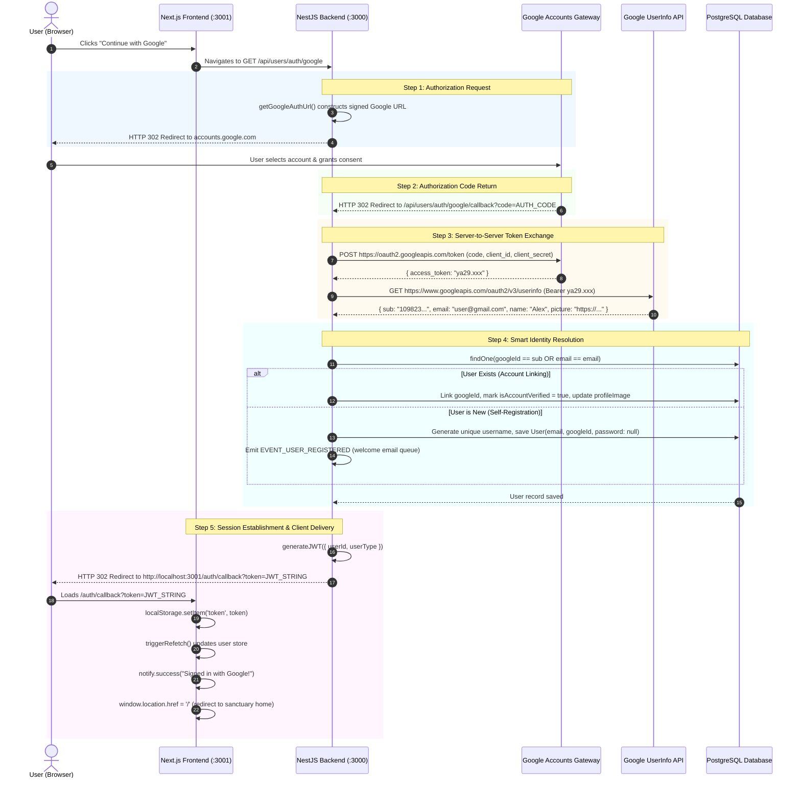

# Google OAuth 2.0 & Social Identity Architecture — Conceptual Guide

> **Document Type:** Conceptual & Engineering Primer  
> **Target Audience:** Full-Stack Engineers, Software Architects, and Backend Developers  
> **Status:** Active / Production-Ready  
> **Subject:** OAuth 2.0, OpenID Connect (OIDC), Social Identity Federation, and Server-Side Authorization Code Flow  
> **System Scope:** NestJS Backend + Next.js (App Router) Frontend + Google Identity Services  

---

## 1. Introduction: The Evolution of Web Authentication

In early web applications, user authentication was strictly **credential-based (Local Authentication)**:
1. The user creates a username and password.
2. The server hashes the password with salt (e.g., using `bcrypt`) and stores it in PostgreSQL.
3. On login, the user re-enters their credentials, the server re-hashes and compares, and issues a session cookie or JSON Web Token (JWT).

```text
[User] ──(Email + Password)──> [NestJS Server] ──(bcrypt.compare)──> [PostgreSQL]
```

### The Inherent Flaws of Password-Only Systems:

1. **User Onboarding Friction:** Asking users to invent, remember, and verify complex passwords leads to high signup abandonment rates.
2. **Password Fatigue & Insecurity:** Users frequently reuse the same password across dozens of websites. If a weak site is breached, credential-stuffing bots compromise accounts on unrelated platforms.
3. **Email Verification Delays:** Traditional email OTPs require third-party SMTP or API calls (e.g., Resend, SendGrid), which are subject to network latency, spam filters, and delivery failures.
4. **Maintenance Overhead:** The engineering team must maintain forgotten-password resets, email verification queues, rate-limiting on login endpoints, and account lockout policies.

---

## 2. What is Social Identity Federation?

**Federated Identity** allows an application to delegate authentication to a trusted third-party Identity Provider (**IdP**) such as Google, GitHub, or Apple.

Instead of managing passwords directly, our system asks Google:
> *"Is this user who they claim to be, and what is their verified email address?"*

Once Google confirms the user's identity, our backend issues an application-specific session token (JWT). The user never has to invent a password, and our database never stores one for that user.

---

## 3. Core Protocols: OAuth 2.0 vs. OpenID Connect (OIDC)

A common point of confusion among engineers is the distinction between **OAuth 2.0** and **OpenID Connect (OIDC)**:

| Protocol | Core Purpose | Answers the Question | Key Artifact |
| :--- | :--- | :--- | :--- |
| **OAuth 2.0** | **Authorization** (Delegated Access) | *"What permissions does this app have to access my resources?"* | **Access Token** |
| **OpenID Connect (OIDC)** | **Authentication** (Identity Verification) | *"Who is the user currently sitting in front of the screen?"* | **ID Token / UserInfo Profile** |

### The Hotel Analogy:

* **OpenID Connect (Authentication):** When you arrive at a luxury hotel, you present your Government Passport at the reception desk. The clerk verifies your face and name. This proves **who you are**.
* **OAuth 2.0 (Authorization):** The clerk hands you an electronic keycard. The keycard does not have your personal medical history or home address on it; it simply grants access to Room 304 and the gym until checkout. This proves **what you are allowed to access**.

In our implementation, we leverage **OIDC on top of OAuth 2.0**:
- We request the scopes `openid`, `email`, and `profile`.
- Google acts as the authorization server that validates the user and grants our server permission to read their basic identity.

---

## 4. Why We Chose the "Authorization Code Flow"

OAuth 2.0 defines several grant types. The two most prominent for web applications are:

### 4.1 The Deprecated "Implicit Flow" (Client-Side Only)

```text
[Browser] ──(Redirects to Google)──> [Google Login] ──(Returns Token in URL Hash #access_token=xxx)──> [Browser]
```
* **Critical Flaw:** The Access Token is exposed directly in the browser address bar and history. Any rogue third-party script, malicious browser extension, or XSS vulnerability can steal the token.
* **Deprecation:** The OAuth working group officially deprecated the Implicit Grant in OAuth 2.1 due to severe security vulnerabilities.

### 4.2 The "Authorization Code Flow" with Server-Side Exchange (Our Architecture)

This is the gold standard for security in modern full-stack web applications:

```text
1. [Browser] ──(Redirects to Google)──> [Google Login Screen]
2. [Google]  ──(Returns temporary short-lived Authorization Code)──> [NestJS Server]
3. [NestJS]  ──(POST Code + Client Secret directly server-to-server)──> [Google Token API]
4. [Google]  ──(Returns Access Token securely to NestJS)──> [NestJS Server]
5. [NestJS]  ──(Fetches Profile, Creates/Finds User, Issues App JWT)──> [Browser]
```

### Key Security Benefits:
1. **The Client Secret Never Leaves the Backend:** The `GOOGLE_CLIENT_SECRET` is kept securely in the backend `.env` file. It is never shipped in frontend JavaScript bundles.
2. **Short-Lived Authorization Code:** The `code` sent to the redirect URI is single-use and expires within a few minutes. Even if intercepted, it is completely useless without the `GOOGLE_CLIENT_SECRET`.
3. **No Direct Third-Party Token Dependency:** The client browser never communicates directly with Google's token servers; our NestJS backend orchestrates the entire handshake.

---

## 5. End-to-End Architecture Sequence Diagram

The following sequence diagram illustrates the complete round-trip flow implemented across our Next.js frontend, NestJS backend, Google Identity servers, and PostgreSQL database:



---

## 6. Smart Account Linking (Identity Resolution)

In production systems, users rarely sign up through a single channel forever. A robust authentication system must handle **Identity Merging** gracefully.

### The Conflict Problem:
1. On Monday, user `alex@gmail.com` signs up with a traditional password and username `@alex`.
2. On Friday, Alex forgets they created a password and clicks **"Continue with Google"** with the same `alex@gmail.com`.

### Two Potential System Behaviors:
* ❌ **Naive Approach (Crash / Duplicate):** Attempting to insert a new user throws a PostgreSQL unique constraint error on `email`, or creates two split accounts for the same real human.
* ✅ **Our Smart Linking Approach:**
  1. The system queries PostgreSQL with:
     ```typescript
     where: [{ googleId: googleUser.sub }, { email: googleUser.email }]
     ```
  2. If an account matches the email, the system safely links the `googleId` to the existing user record without altering their existing password or orders!
  3. The account's `isAccountVerified` flag is upgraded to `true` (since Google has already verified email ownership).
  4. If the user had no avatar, Google's high-resolution `picture` is set as their `profileImage`.

---

## 7. Account Lifecycle & Soft-Delete Grace Period

Our application implements soft deletes (`@DeleteDateColumn() deletedAt: Date | null`). 

If a user previously deleted their account, our business rules guarantee a **30-day grace period**:
- When logging in via Google, if `user.deletedAt` is present:
  - The system automatically invokes `this.usersRepository.restore(user.id)`.
  - Sets `user.deletedAt = null`.
  - The user seamlessly recovers their account without contacting customer support.

---

## 8. Guarding Against Hybrid Authentication Vulnerabilities

When an account is created exclusively via Google OAuth, `password` is stored as `null`.

### What happens if an attacker attempts to log in with that email using the regular password form?

If our traditional login handler executed:
```typescript
await bcrypt.compare(submittedPassword, user.password); // user.password is null!
```
Two disasters would occur:
1. **Runtime Server Crash:** `bcrypt.compare` throws an uncaught `TypeError` because the hash parameter cannot be `null`.
2. **Ambiguous UX:** The user would see a misleading "Invalid email or password" error.

### Our Defensive Solution:
Before invoking `bcrypt`, the service evaluates:
```typescript
if (!user.password) {
    throw new BadRequestException(
        "This account was registered using Google. Please click 'Continue with Google' to sign in."
    );
}
```
This protects process stability and guides the user to the proper login button.

---

## 9. Architectural Summary

| Layer | Responsibility | Security Measure |
| :--- | :--- | :--- |
| **Frontend UI** | Initiates redirect via `window.location.href` | Zero client secrets; pure navigation |
| **NestJS Controller** | Handles `/api/users/auth/google` & `/google/callback` | Validates query parameters; encapsulates redirect targets |
| **NestJS Service** | Exchanges code for tokens via native `fetch` | Communicates over TLS directly with Google; client secret kept server-side |
| **PostgreSQL Database** | Stores `googleId`, nullable `password`, verified status | Unique constraints on `email` and `googleId` prevent collisions |
| **Frontend Callback** | Extracts JWT from URL query, writes to `localStorage` | Uses React `<Suspense>` and `useRef` to prevent double-execution in StrictMode |
